# Mechanical Design Explorer

Interactive engineering tools for the questions mechanical, quality and manufacturing engineers ask every day: **will this beam or shaft survive, will these parts assemble and which tolerance should be tightened, and where does a pump and pipe system lose pressure or cavitate.** A fourth chapter collects the small calculators these tools rely on: thread, pipe and tolerance-grade tables, wall thickness under pressure and plate stiffness.

**[Open the live app](https://mechanical-design-explorer-dt92wtfsjydzt3htt2zmkg.streamlit.app/)** · Built with Python, NumPy, Pandas, Plotly and Streamlit · Free hosting, so the first load may take a few seconds.

> **For learning and screening, not certified design.** Example inputs are illustrative, not from real projects. Pump data, loss coefficients, material properties and tolerance values are generic textbook-style numbers.

## What it does

All chapters share a sidebar with a chapter dropdown, SI or US units, a **Reset to defaults** button and an **About this chapter** box that states the method, the checks and the limitations. Dimension sliders have an exact-entry box beside them, and impossible inputs (zero diameter, negative span and so on) give a clear message instead of a crash.

### 1. Beam, shaft & column stress
*Question: does this part carry the load with enough margin?*

- **Beam:** five support cases (simply supported, cantilever, fixed at both ends, propped cantilever, overhanging) under a point load, a full-length uniform load or both. Cross-sections: rectangle, solid round, hollow round, hollow rectangular tube and I-beam, with six typical materials (E, yield and ultimate shown) or a custom one.
- **Shows** the part coloured blue (low stress) to red (near yield) on its deformed shape, shear and moment diagrams, deflection against an optional span ÷ ratio limit, safety factor and a pass or fail against the required safety factor.
- **Shaft mode** adds torque (τ = Tc/J), a von Mises equivalent stress and an optional **Goodman fatigue check** with a stress concentration factor Kt.
- **Column mode** screens buckling with **Euler** (long) and the **Johnson parabola** (short and intermediate) for four end conditions, and draws the buckling mode and the column strength chart.
- Choosing a stronger material changes the safety factor and the colour scale, not the stress pattern.
- Method: a small 1D Euler-Bernoulli finite-element model, cross-checked against closed-form beam equations. It is a cross-check tool, **not general FEA**.

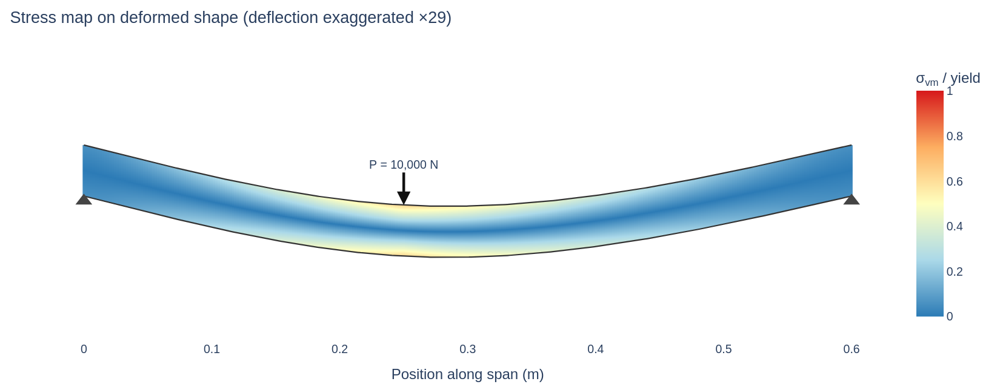
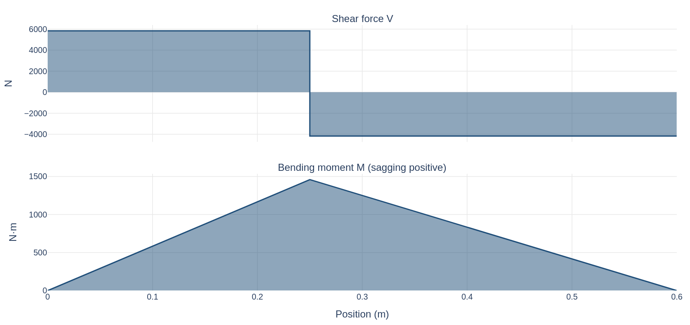
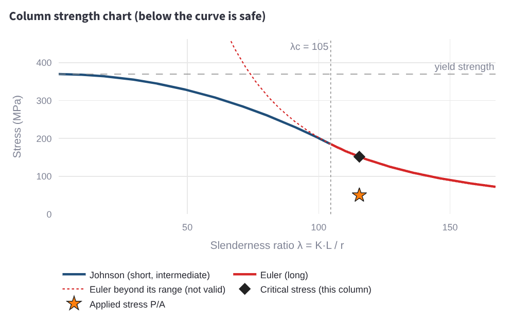

### 2. Pump & pipe system
*Question: where does this system lose pressure, what flow will the pump deliver, will it cavitate, and what does it cost to run?*

- **System:** suction and discharge pipe diameter and length, tank levels, bends, valves, fittings, pump speed and water temperature. Pipe roughness, valve K and fitting K can be picked from a list or entered directly. Tank gauge pressures and site elevation (standard atmosphere) enter the static head and NPSH. A **custom fluid** (density, viscosity, vapour pressure) can replace water.
- **Pump:** a quadratic curve from a design point or **fitted to entered points** (the fit residual is shown), scaled with the affinity laws. One or two identical pumps can run **in parallel or in series**.
- **Results:** the pipe layout coloured by pressure or velocity, the operating point (pump curve against system curve), the bottleneck section with the largest pressure drop, and a cavitation check that compares NPSH available with NPSH required.
- **Energy and cost:** pump efficiency, shaft and electrical power and yearly energy cost at the operating point (efficiency curve and motor and drive efficiencies are assumed, not manufacturer data), plus a **throttle valve vs variable-speed drive** comparison at a lower flow showing the head the valve wastes and the power and cost the drive saves.
- **Examples and export:** five illustrative example systems (a baseline, an undersized pipe, a hot-water suction lift, two pumps in parallel, a pressurised glycol loop at altitude) and CSV downloads of the section table and the curves, in the chosen units.
- Method: Darcy-Weisbach friction with a laminar or Colebrook-White friction factor, fitting losses from loss coefficients, and system-curve analysis. This is **not CFD**.

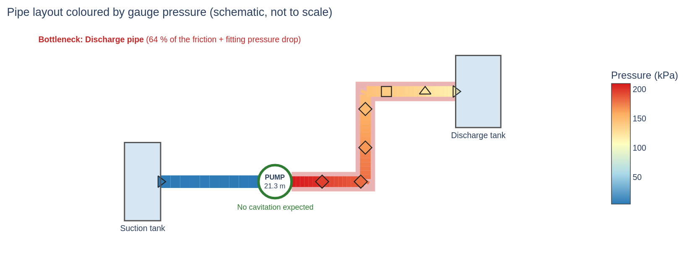
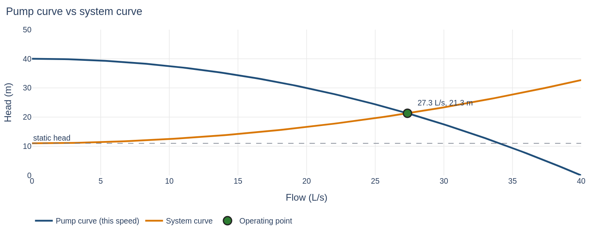
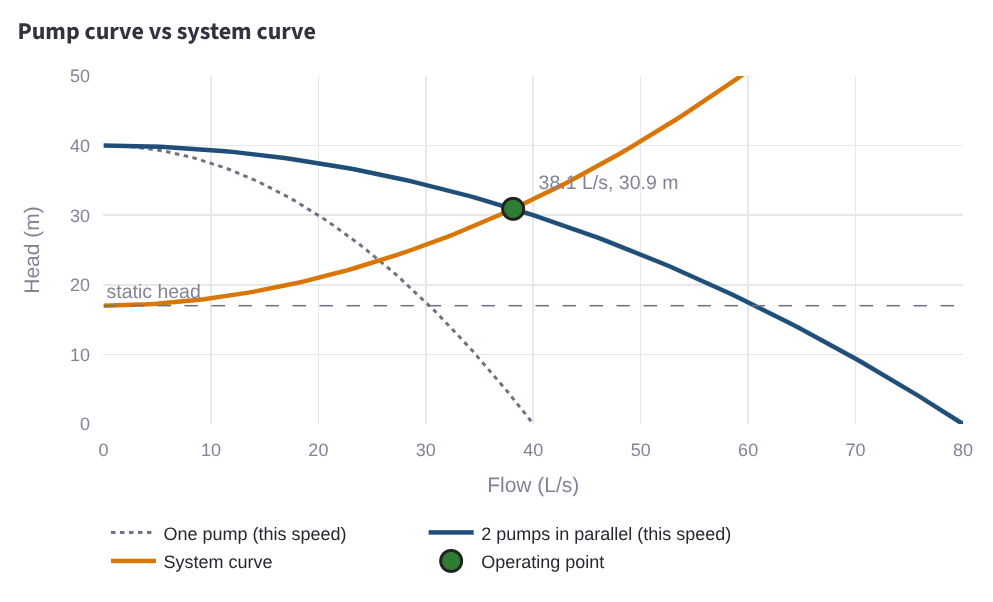
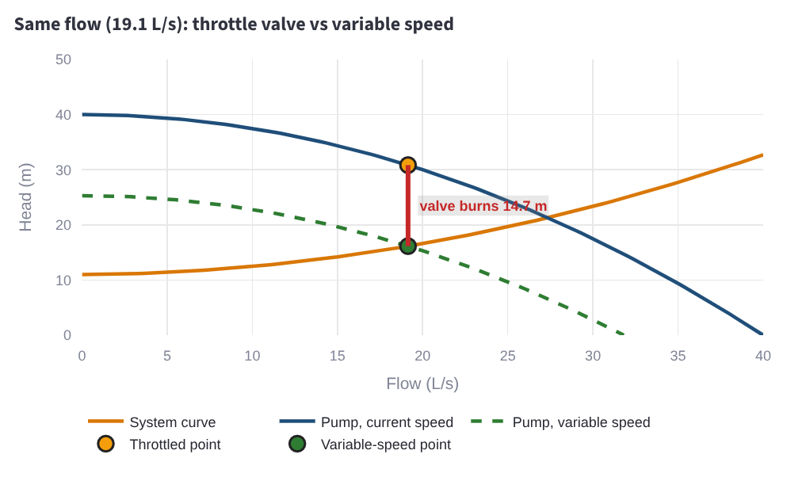

### 3. Tolerance stack-up & GD&T
*Question: will these parts assemble, and which dimension should be tightened?*

- **Size stack-up:** dimensions and tolerances in an editable table (nominal, +tol, −tol, direction, distribution, optional mean shift). Each row can be normal, uniform or triangular. It compares **worst-case, RSS and Monte Carlo**, shows the gap histogram against the spec limits, and reports **Cp, Cpk, estimated ppm out of spec and sigma level**.
- **Which dimension to tighten:** the contribution of each dimension is ranked, and a **tolerance budget solver** finds the scale factor that reaches a target Cpk.
- **Examples and export:** example stacks load into the table, and the results table downloads as CSV.
- **GD&T position tab:** a position tolerance zone for a hole or pin with **bonus tolerance at MMC or LMC** drawn to scale, a pass or fail, the virtual condition, and the same part judged at RFS for comparison. A **fastener formula calculator** gives the position tolerance for floating (T = H − F) and fixed (T = (H − F)/2 per part) fasteners from hole and fastener sizes.
- A learning tool based on ASME Y14.5 concepts. **It is not a certified interpretation of the standard.**

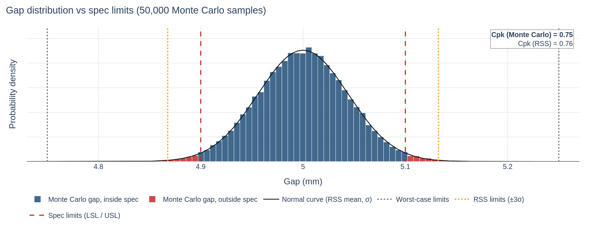
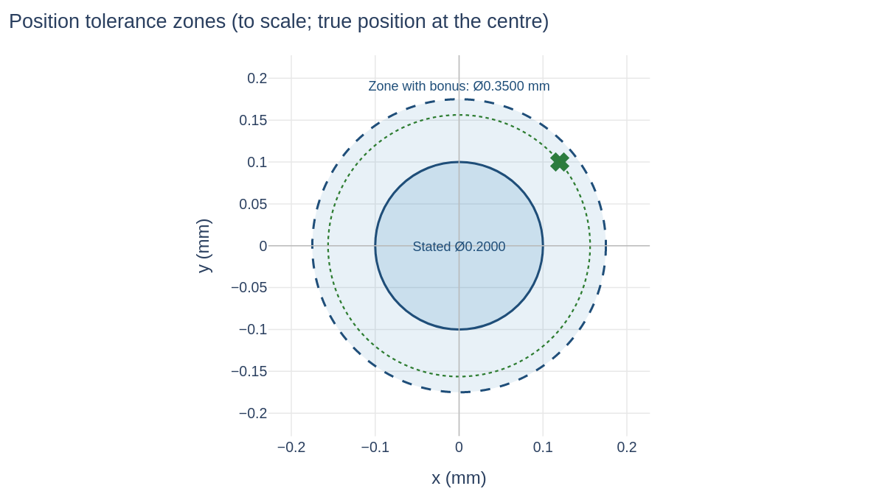

### 4. Basic tools & examples
*Question: what are the standard sizes and the quick checks I need while using the other three chapters?*

- **Units & validation:** a diameter demo and two small cases (a round tube and a simply supported beam) showing the clear message every chapter gives for an impossible input.
- **Threads & fasteners:** ISO metric (M3 to M30, coarse and common fine pitches) and UNC/UNF (#4 to 1-1/4 in) thread geometry and **tensile stress area**, an approximate tap drill, ISO 273 close and normal **clearance holes**, and the **floating-fastener position tolerance T = H − F** used in Chapter 3.
- **Pipe sizes:** NPS 1/2 to 8, schedule 40 and 80 (ASME B36.10M): outside and inside diameter, wall, flow area and the mean velocity at a flow. The inside diameter is the pipe diameter to use in Chapter 2.
- **Wall under pressure:** thin-wall and thick-wall (Lamé) hoop and axial stress for internal pressure, the required wall for an allowable stress with a corrosion allowance, and a pass or fail. A stress screening of a plain cylinder, **not a pressure-vessel or piping code design**.
- **Thickness sensitivity:** a tip-loaded cantilever plate showing that deflection falls with the cube of the thickness and stress with its square, with warnings for short plates and large deflections.
- **Tolerance grades:** ISO 286-1 standard tolerance grades IT5 to IT12 by nominal size, with the hole H, shaft h and symmetric js zones to enter in Chapter 3's stack-up table.
- The chapter is listed last in the dropdown by a small `ORDER` setting (see "Add a chapter").

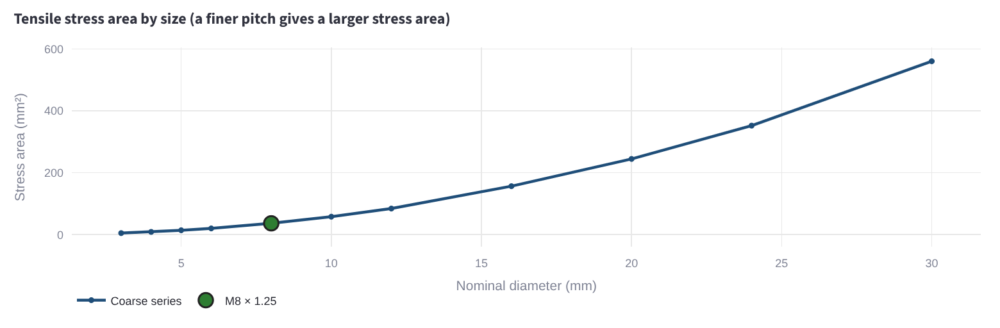
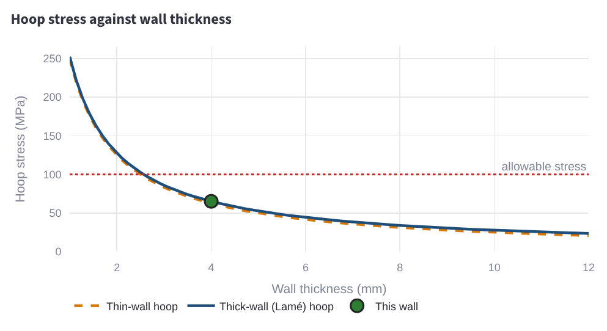
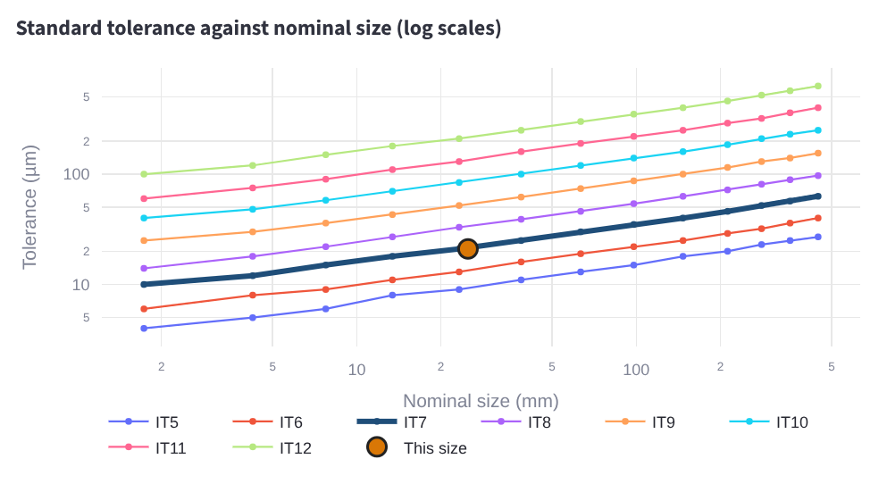

*The images are screenshots of the app's own charts with illustrative inputs.*

## How the results are checked

700 automated tests (`python -m pytest`) cover the calculations, the input validation and the app itself. Calculations are pure functions with no Streamlit dependency, so they are tested directly against textbook formulas and hand calculations.

| Area | Tests | What is checked |
|---|---|---|
| Beam, shaft & column | 194 + 5 app | Reactions, shear and moment for point and uniform loads (PL/4, wL²/8); deflection against PL³/48EI, PL³/3EI, 5wL⁴/384EI and wL⁴/8EI; fixed-fixed end moments (Pab²/L², wL²/12), propped cantilever and overhanging beam reactions; force and moment equilibrium for every support and load case; the small 1D finite-element model against the closed form; section properties for five cross-sections; torsion τ = Tc/J; von Mises; endurance limit, Goodman and the Kt factor; custom material and deflection-limit checks; Euler load π²EI/(KL)² for four end conditions and the Johnson curve joining Euler at the slenderness limit; invalid loads and sections; figures build |
| Tolerance stack-up & GD&T | 131 + 15 app | Worst-case, RSS (√Σt²) and Cpk against hand values for a worked stack; the normal, uniform and triangular variances; mean shift; Cp, ppm and sigma level; the budget scale factor and its round trip; asymmetric tolerances; contribution shares; Monte Carlo against the analytic mean, σ and tail fraction (fixed seed); example stacks and CSV contents; bonus tolerance, zone and virtual condition at MMC, LMC and RFS; the fastener formulas; boundary and out-of-size cases; invalid rows, spec limits and sample counts |
| Pump & pipe | 137 + 19 app | Laminar f = 64/Re; Colebrook against the Moody chart and Swamee-Jain; Darcy-Weisbach and minor-loss hand values; an independent hand calculation of the system head; affinity laws; analytic operating point; NPSH available and cavitation thresholds; water vapour pressure; energy balance along the layout; hydraulic, shaft and electrical power and yearly cost by hand; the drive speed against its closed form and the operating-point solver; the throttle loss against an equivalent valve added to the layout; the pump-curve fit against a hand regression and numpy; parallel and series curves and operating points against closed forms; standard-atmosphere values and tank-pressure static head by hand; a custom fluid with water's own properties against the water result; density scaling; example systems; CSV contents and unit conversion; weak pump (no operating point); invalid layouts, pumps, fluids and inputs |
| Basic tools & examples | 131 (7 app) | Thread geometry by hand; tensile stress areas against the published ISO 898-1 table (20 coarse and fine sizes) and the UNC/UNF tables; clearance-hole tables for consistency; T = H − F; pipe bores, flow area and velocity; thin-wall and Lamé stresses with force-balance checks, required walls and the round trip; cantilever plate deflection and stress against PL³/3EI and Mc/I with the cube and square laws; the ISO 286-1 tolerance grade table, its size-range boundary rule and the T = k·i formula; every invalid input |
| Shared code | 68 | Unit conversions and round trips (26), slider stepping (15), validation helpers (11), sidebar and sliders (6), chapter auto-discovery and ordering (6), app smoke tests (4) |

## Limitations

- **Beam, shaft & column:** linear-elastic, one point load and/or a full-length uniform load, self-weight ignored. Transverse shear, web crippling, local buckling of thin walls, stress concentrations (apart from the Kt input) and contact stresses are not included. Rectangular tubes and I-beams are bending only (no torsion). The Goodman check uses a simplified endurance limit (k · 0.5 · Su, capped at 700 MPa) and applies the same load ratio to bending and torque. Columns are straight and centrally loaded, with no imperfections or eccentricity: a classroom Euler and Johnson screen, not a code-based column design. The 1D finite-element model is a cross-check, not a general FEA tool.
- **Pump & pipe:** one series path with one pipe material. Loss coefficients are rounded textbook values and real fittings vary. The pump curve is quadratic; the NPSH-required shape, the pump efficiency curve and the constant motor and drive efficiencies are assumptions, not manufacturer data. The pump curve is not corrected for fluid viscosity, so results for viscous liquids are indicative only, and a custom fluid's properties do not change with temperature. Pump pairs are identical, run at the same speed and are always both running; interaction between pumps and check-valve losses are ignored. Pipe elevation changes in the colour map, water hammer, two-phase flow and parallel branches are not modelled. Flow between Re 2300 and 4000 is flagged as transitional and its friction factor is only a guide.
- **Tolerance stack-up:** one-dimensional linear stacks with no correlation between dimensions. Each tolerance band follows the chosen distribution (normal bands are ±kσ with k selectable, default 3), and Monte Carlo samples are not truncated at the limits. Cpk and ppm from RSS assume the summed gap is roughly normal. Process drift, 2D or 3D stacks and non-normal gap shapes beyond the three row distributions are not modelled.
- **GD&T:** a single feature of size with one position zone at MMC, LMC or RFS. Datum reference frames and datum shift, composite or projected tolerance zones, and orientation and form controls are not modelled. The fixed-fastener formula assumes the fixed fastener's perpendicularity is controlled.
- **Basic tools & examples:** nominal dimensions and tabulated values only. Thread sizes are limited to M3 to M30 and #4 to 1-1/4 in with no tolerance classes or proof loads. Pipe sizes are NPS 1/2 to 8 carbon-steel B36.10M values. Some published charts round medium clearance holes differently (for example M12 and M16). The wall-thickness tab ignores weld joint efficiency, temperature, external pressure and the piping and pressure-vessel codes. The plate tab uses linear beam theory. Tolerance grades are IT5 to IT12 up to 500 mm, without fundamental deviations or fit classes. Table values are for learning and screening: confirm them against the standard for real work.

## Run it locally

```bash
pip install -r requirements.txt     # streamlit>=1.50, plotly, pandas, numpy, pytest
streamlit run app.py                # all chapters
streamlit run chapters/pump_pipe.py # one chapter on its own
python -m pytest                    # the test suite
```

## Add a chapter

`app.py` finds every file in `chapters/` automatically, so a new chapter needs **no edits to `app.py`**.

1. Copy `chapters/_template.py` to `chapters/<your_chapter>.py` (no leading underscore).
2. Set `TITLE` and `DESCRIPTION` (optionally `KEY_PREFIX`, `ABOUT` and `ORDER`: chapters are listed by `ORDER`, default 50, then by filename), put the calculations in pure functions (SI in, SI out, no Streamlit) at the top of the file, and write the interface in `render()`.
3. Import only from `common/` and never from another chapter. Raise `ValidationError` (from `common/validation.py`) for impossible inputs.
4. Run it alone with `streamlit run chapters/<your_chapter>.py`, add tests that import it with `from chapters import <your_chapter>`, then reload the app: it appears in the chapter dropdown.

## Project layout

```
app.py              base shell: chapter dropdown, units, disclaimer
chapters/           one file per chapter (beam_shaft, pump_pipe, tolerance_stack, basic_tools), plus _template.py
common/             units (SI and US), validation, plot theme, shared UI helpers, chapter discovery
tests/              pytest and Streamlit AppTest suites
docs/               chart images used in this README
```

## About

Built by [Gaurav Haresh Patil](https://gp26902.github.io), industrial and mechanical engineer (M.S. Industrial Engineering, B.E. Mechanical Engineering). More projects are on the [portfolio](https://gp26902.github.io).
